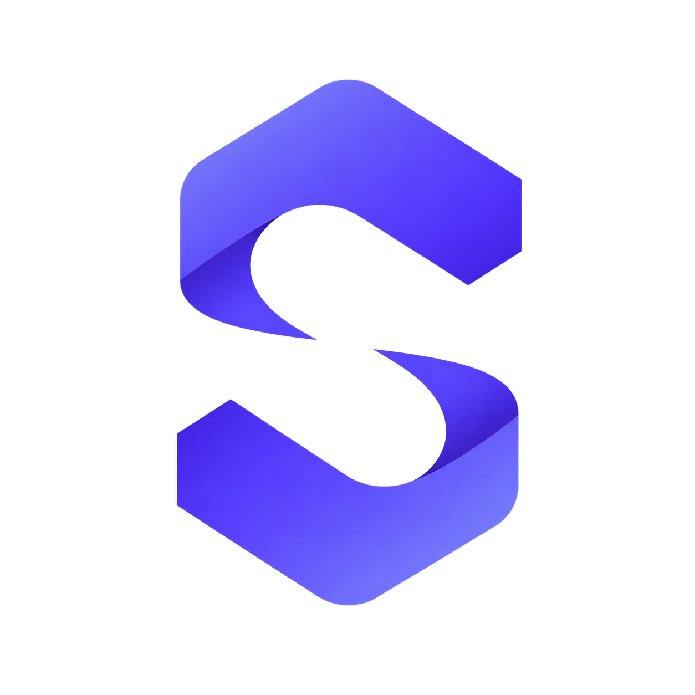
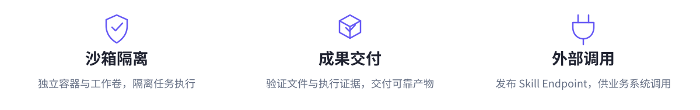
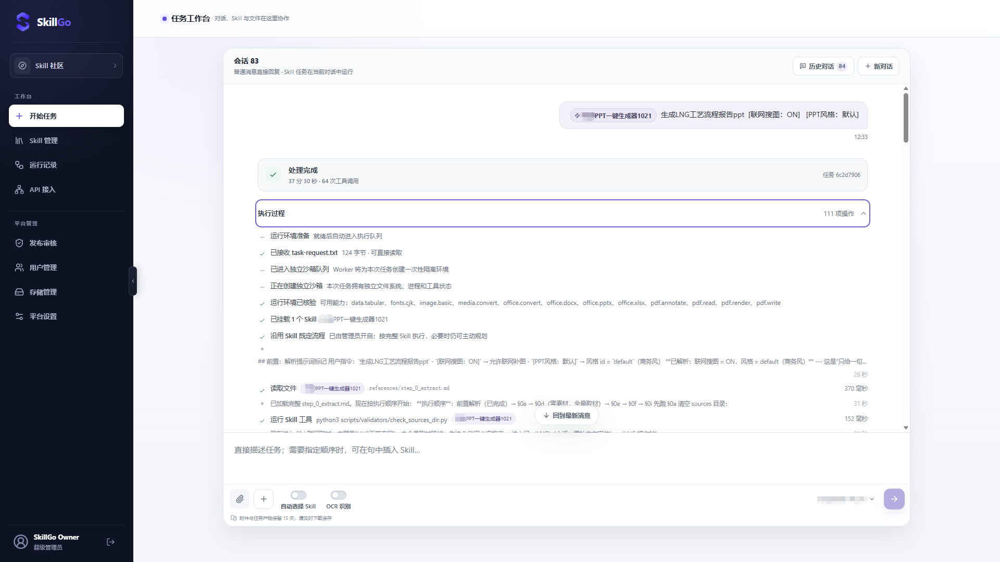
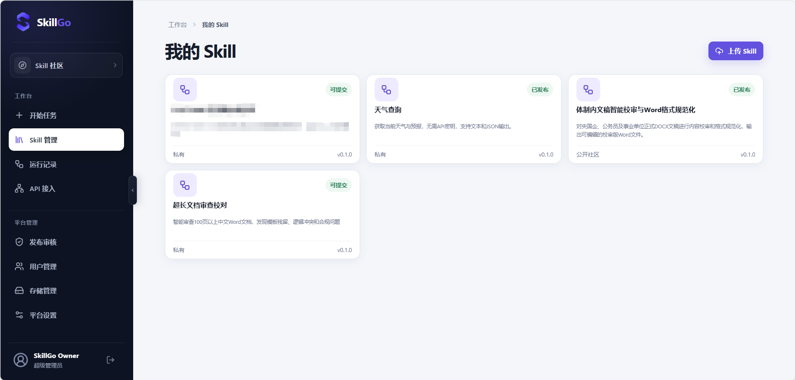
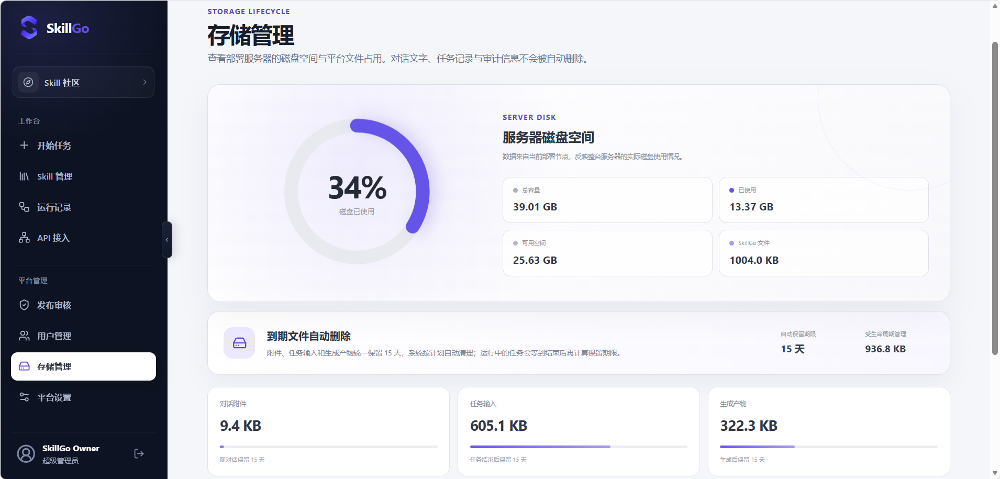
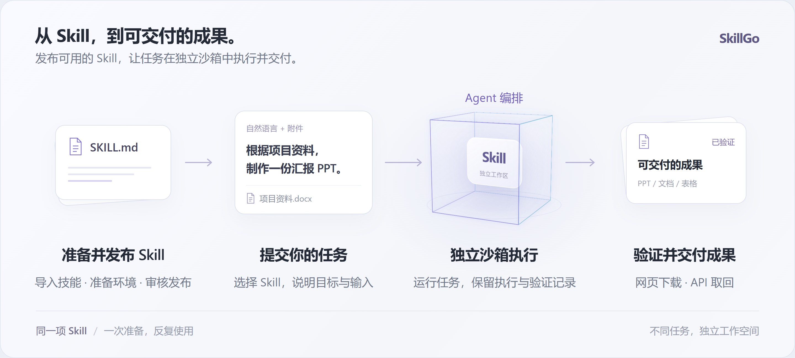
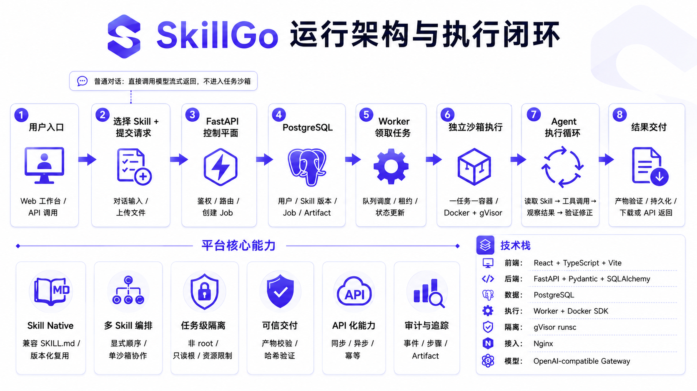

<p align="center">
  
</p>

<h1 align="center">SkillGo</h1>

<p align="center">
  <strong>把好用的 Skill，变成每个人的能力。</strong><br />
  沙箱隔离 · 成果交付 · 外部调用
</p>

<p align="center">
  <sub>A self-hosted platform for running agent skills in isolated sandboxes and delivering artifacts through the web or API.</sub>
</p>

<p align="center">
  <a href="LICENSE"></a>
  <a href="https://github.com/Max-cu/SkillGo/releases"></a>
  <a href="https://github.com/Max-cu/SkillGo/actions/workflows/ci.yml"></a>
  
  
</p>

<p align="center">
  <a href="#产品演示">产品演示</a> ·
  <a href="#核心能力">核心能力</a> ·
  <a href="#使用流程">使用流程</a> ·
  <a href="#快速开始">快速开始</a> ·
  <a href="#api-接入">API 接入</a> ·
  <a href="#开发与文档">开发与文档</a>
</p>

SkillGo 是一个可私有化部署的多用户 Skill 平台。上传现有的 `SKILL.md` 技能包，准备环境并审核发布，再通过自然语言和附件发起任务。Agent 在独立沙箱中执行，平台验证并交付生成的文件；同一项 Skill 能力也可以发布为 API，接入已有业务系统。

## 产品演示

**第一次了解 SkillGo？不妨先观看这段 1 分 41 秒的产品演示。**

以 PPT 制作为例，直观了解 SkillGo 如何将 Skill 转化为可执行、可交付、可供业务调用的能力。视频配有中文配音与中英双语字幕。

https://github.com/user-attachments/assets/eb3e6cdf-cda6-434b-a0a9-4cc0d37262f4

<p align="center">
  <a href="https://github.com/user-attachments/assets/eb3e6cdf-cda6-434b-a0a9-4cc0d37262f4">下载演示视频</a> · 1080p · 60 fps
</p>

> **说明：** 视频展示 SkillGo 的产品流程。具体文档、表格、演示稿及图像处理能力取决于所上传的 Skill 和配置的模型。
## 核心能力

<p align="center">
  
</p> 

### 平台功能

<p>
  &nbsp;&nbsp;
  <strong>Skill 管理</strong> — 技能导入、版本管理、审核发布、社区共享
</p>

<p>
  &nbsp;&nbsp;
  <strong>对话工作台</strong> — 自然语言交互、附件处理、历史文件复用
</p>

<p>
  &nbsp;&nbsp;
  <strong>Agent 执行</strong> — 多 Skill 协调、Python / 命令执行、进度追踪与成果交付
</p>

<p>
  &nbsp;&nbsp;
  <strong>模型与环境</strong> — 多模型连接、视觉与 OCR、环境准备及依赖解析
</p>

<p>
  &nbsp;&nbsp;
  <strong>团队与运维</strong> — 权限管理、操作审计、文件保留、备份与恢复
</p>

### 界面预览

<details>
<summary>任务工作台与执行过程</summary>

<p align="center">
  
</p>

</details>

<details>
<summary>Skill 管理与存储界面</summary>

<table>
  <tr>
    <td width="50%">
      <br />
      <sub>Skill 管理与发布</sub>
    </td>
    <td width="50%">
      <br />
      <sub>存储与生命周期管理</sub>
    </td>
  </tr>
</table>

</details>

## 使用流程

<p align="center">
  
</p>

1. **准备能力**：上传 Skill ZIP，解析说明、执行画像与依赖；需要环境准备的版本先完成构建与探测，再审核发布。
2. **提出任务**：选择 Skill、描述目标并添加附件。普通对话与 Skill 任务可以出现在同一会话中。
3. **跟踪执行**：查看计划、关键进度和生成文件，按需展开完整工具记录；交互任务缺少关键输入时可以等待用户回答。
4. **获得结果**：下载验证通过的真实文件。失败、取消或受阻会保留状态与原因，支持查看和重试。

一个任务可以选择多个 Skill，由一个 Agent 在该任务工作区内协调执行；不同任务使用独立工作卷。Skill 格式、限制与示例见 [Skill 包说明](docs/skill-packages.md) 和 [`examples/`](examples/)。

## 快速开始

### 先体验界面与对话

准备 Git、Docker Engine / Docker Desktop 和 Docker Compose v2：

```bash
git clone https://github.com/Max-cu/SkillGo.git
cd SkillGo
cp .env.example .env
```

编辑 `.env`，替换 `POSTGRES_PASSWORD`、`SKILLGO_JWT_SECRET`、`SKILLGO_BOOTSTRAP_EMAIL` 和 `SKILLGO_BOOTSTRAP_PASSWORD`，然后启动：

```bash
docker compose up -d --build
```

打开 **http://127.0.0.1:8080**，使用配置的 Bootstrap 超级管理员账号登录，并在平台设置中配置模型。Windows PowerShell 可以用 `Copy-Item .env.example .env` 替代 `cp`。

**基础模式启动 Web、API 和数据库，可管理 Skill 与进行普通对话；运行脚本任务还需要下面的沙箱模式。**

### 启用沙箱执行

需要 **Linux + Docker Engine + 已注册到 Docker 的 gVisor `runsc`**。先按 [部署指南](deploy/README.md) 安装运行时、配置 Docker Socket GID 和访问地址，再执行：

```bash
cp deploy/ecs.env.example deploy/ecs.env
# 编辑 deploy/ecs.env：填写 Docker GID、访问地址和端口
docker compose --env-file .env --env-file deploy/ecs.env --profile build-only build sandbox-runtime
bash deploy/preflight.sh
docker compose --env-file .env --env-file deploy/ecs.env --profile sandbox up -d --build --scale worker=12
SKILLGO_INSTALL_ROOT="$PWD" bash deploy/verify-ecs.sh
```

示例启动 12 个 Worker，可按宿主资源用 `--scale worker=N` 调整。`deploy/ecs.env.example` 默认监听 80 端口，并覆盖根目录 `.env` 的同名配置。环境准备和持久化恢复默认关闭，可分别按 [执行环境与隔离](docs/execution-and-isolation.md) 启用。

## API 接入

为已审核、可运行的 Skill 版本创建 Endpoint，使用其独立密钥调用。密钥只在创建或轮换时完整展示，请妥善保存。

| 调用方式 | 接口 | 返回 |
| --- | --- | --- |
| 纯指令同步调用 | `POST /api/v1/invoke/{slug}` | 结构化结果与 `run_id` |
| 沙箱异步任务 | `POST /api/v1/workflow-endpoints/{slug}/jobs` | `202 Accepted`、任务 ID 与查询地址 |

以下示例提交文件与制作要求，并通过 `Idempotency-Key` 避免重复创建任务：

```bash
export SKILLGO_BASE_URL="https://skillgo.example.com"
export SKILLGO_API_KEY="<你的 Endpoint 密钥>"

curl "$SKILLGO_BASE_URL/api/v1/workflow-endpoints/your-slug/jobs" \
  -H "X-SkillGo-Key: $SKILLGO_API_KEY" \
  -H "Idempotency-Key: request-001" \
  -F "file=@./input.docx" \
  -F "instruction=根据资料制作项目汇报 PPT，突出关键进展与下一步计划"
```

提交后查询任务状态，再下载产物。外部任务无人值守执行，不向用户追问；信息不足时，Agent 采用合理假设并在结果中说明。完整请求契约、错误码和密钥管理见 [任务 API](docs/workflow-api.md)，可运行示例见 [Python 客户端](examples/workflow_api_client.py)。开发环境交互文档：`http://127.0.0.1:8000/api/docs`。

## 架构与边界

<p align="center">
  
</p>

```text
浏览器 / 业务系统 → Web + FastAPI → PostgreSQL / 文件存储
                          ↓
                 可信 Worker + 模型编排
                          ↓
               独立任务容器（gVisor runsc）
```

- 沙箱采用非 root、只读根文件系统、独立工作卷及可配置资源预算；任务容器不注入平台密钥或挂载 Docker Socket。
- 运行联网默认关闭。多 Skill 任务中，只要一个选中版本获准联网，整个任务沙箱即可联网；当前不限制目标域名。
- 多 Skill 协调执行不等于通用并行 DAG 或多 Agent 调度；快照恢复的是工作文件和 Agent 状态，不是进程内存。
- Worker 与环境准备服务属于可信控制面，gVisor 不能替代宿主机维护、权限控制和 HTTPS 配置。

隔离、工具、验证、依赖、恢复和数据保留策略见 [执行环境与隔离](docs/execution-and-isolation.md)；安全问题见 [SECURITY.md](SECURITY.md)。

## 开发与文档

本地开发使用 **Python 3.12 + Node.js 24**；后端为 FastAPI，前端为 React / TypeScript。

| 入口 | 内容 |
| --- | --- |
| [部署指南](deploy/README.md) | Linux / gVisor、安装、升级、备份、恢复与自检 |
| [开发指南](docs/development.md) | 本地环境、模型配置、测试与构建 |
| [Skill 包说明](docs/skill-packages.md) | `SKILL.md`、扩展声明、上传限制与示例 |
| [任务 API](docs/workflow-api.md) | Endpoint、异步调用、状态查询与产物下载 |
| [执行环境与隔离](docs/execution-and-isolation.md) | Agent、验证、依赖、权限、恢复与数据保留 |
| [产品与技术架构](docs/PRODUCT_ARCHITECTURE.md) | 产品边界与系统分层 |
| [Agent 内核](docs/agent-kernel.md) | 编排、工具、上下文与验证设计 |
| [文档索引](docs/README.md) | 当前文档与历史阶段资料 |

本文描述当前 `main`。生产部署请选择经过验证的提交或 [Release](https://github.com/Max-cu/SkillGo/releases)，结合对应版本文档；历史设计记录不代表当前功能开关或部署状态。

## 参与项目

欢迎提交问题、改进建议与 Pull Request。如果你也认可 SkillGo ，欢迎点一个 Star⭐，这对我们很重要 ^_^

开发约定见 [CONTRIBUTING.md](CONTRIBUTING.md)，安全问题请按 [SECURITY.md](SECURITY.md) 私下报告。SkillGo 使用 [MIT License](LICENSE)。
